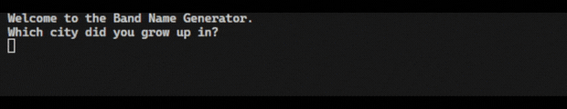

# Working with Variables in Python to Manage Data
## Concepts
- Printing to the console in Python.
- String manipulation and code intelligence.
- Debugging.
- Input function.
- Variables and naming.
## Band Name Generator

