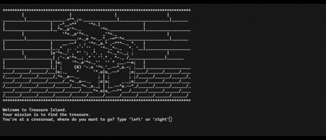

# Control Flow and Logical Operators
## Concepts
- Control flow with conditional operators.
- Modulo operator.
- Nested if statements and elif statements.
- Multiple if statements in succession.
- Logical operators.
## Treasure Island

