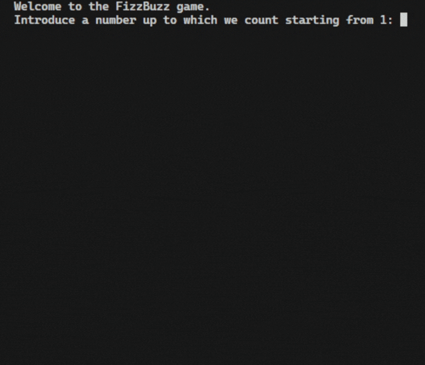
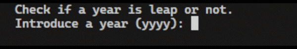
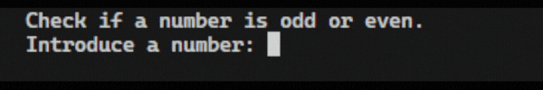

# Debugging
## Concepts
- Describing the problem.
- Reproducing the bug.
- Fixing Errors and watching for red underlines.
- Squashing bugs with a print statement.
- Using a debugger.
## FizzBuzz

## Leap Year

## Odd or Even

