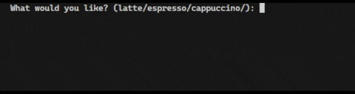
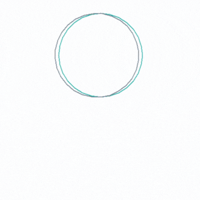

# Object Oriented Programming (OOP)
## Concepts
- Classes and objects.
- Constructing objects and accessing their attributes and methods.
- Adding Python packages and use PyPi.
- Modifying object attributes and calling methods.
## OOP The Coffee Machine

## Pokemon Pretty Table

## Turtle Spirograph

