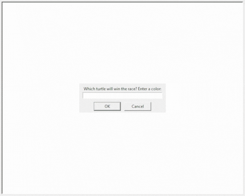

# Instances, State and Higher Order Functions
## What for?
- Python higher order functions & event listeners.
- Object state and instances.
- Turtle module, understanding the coordinate system.
## Turtle Race Project

