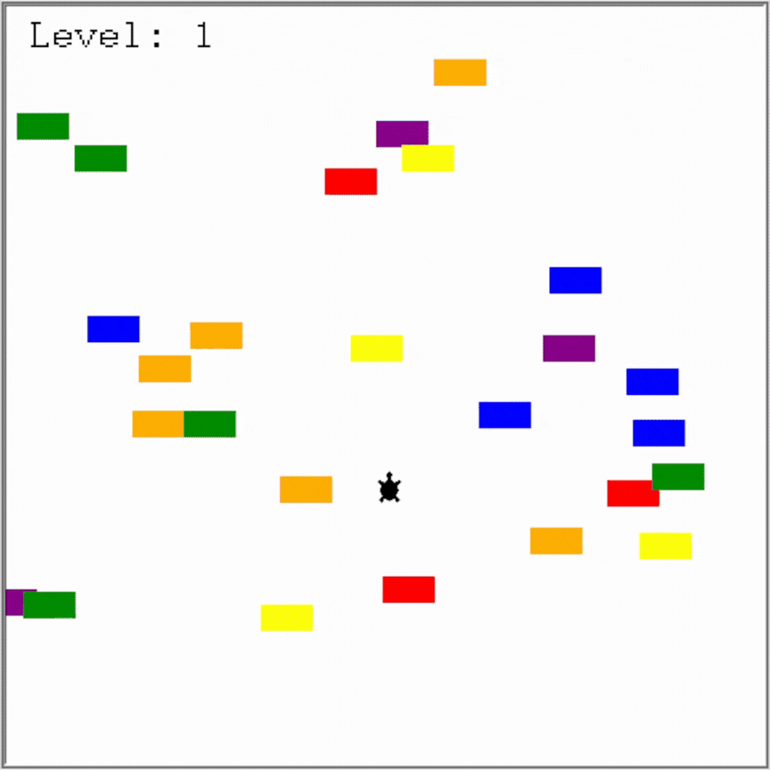

# The Turtle Crossing Project
## Process
- Create the player behaviour.
- Create the car behaviour.
- Detect collision with a car.
- Detect when the player has reached the other side.
- Add the scoreboard and game over sequence.
## Showcase

