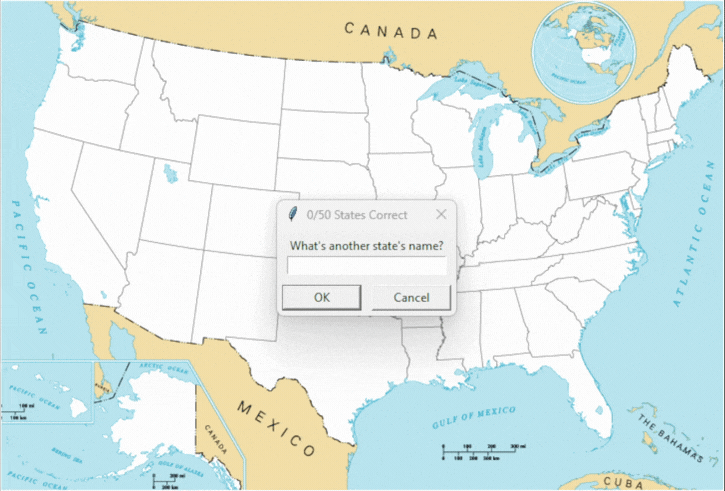

# Working with CSV Data and the Pandas Library
## What for?
- Reading CSV Data in Python.
- DataFrames and Series.
- Working with Rows and Columns.
- Data Analysis with Pandas.
## U.S. States Game

