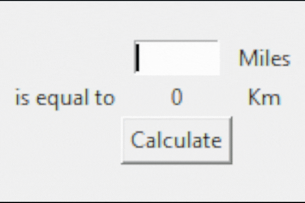

# Tkinter, *args, **kwargs and Creating GUI Programs
## Concepts
- History of GUI and introduction of Tkinter.
- Creating windows and labes with Tkinter.
- Setting default values for optional arguments inside a function header.
- *args: positional arguments.
- **kwargs: keyword arguments.
- Setting component options.
- Tkinter widgets: Radiobuttons, Scales, Checkbuttons and more.
- Tkinter layout managers: pack, place and grid.
## Miles to Kilometers Converter Project

