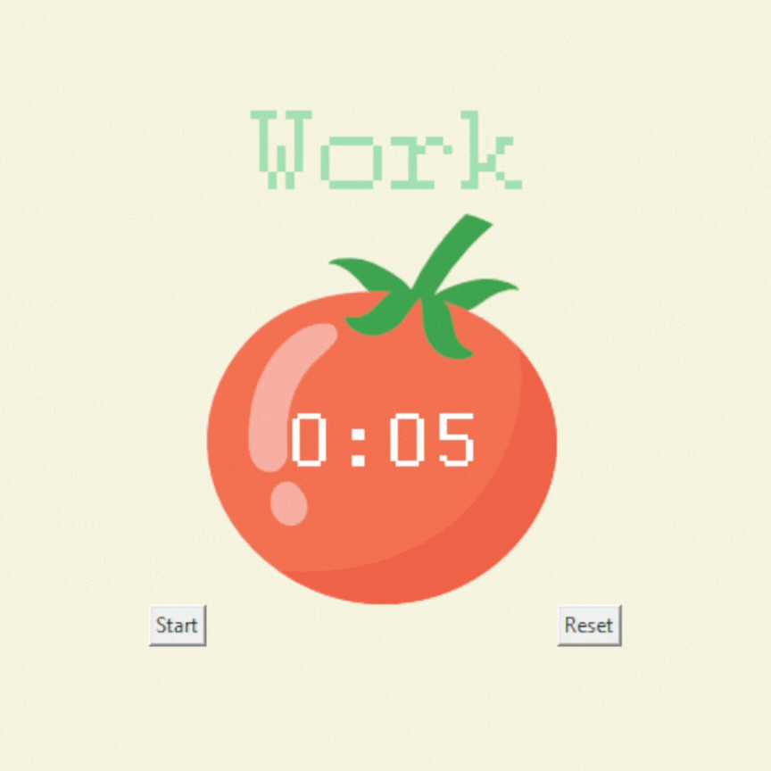

# Tkinter, Dynamic Typing and the Pomodoro GUI Application.
## Concepts
- Working with Canvas widget and add images to Tkinter.
- Adding a count down mechanism.
- Dynamic typing.
- Setting different timer sessions and values.
- Adding checkmarks and resetting the application.
## Pomodoro Timer

