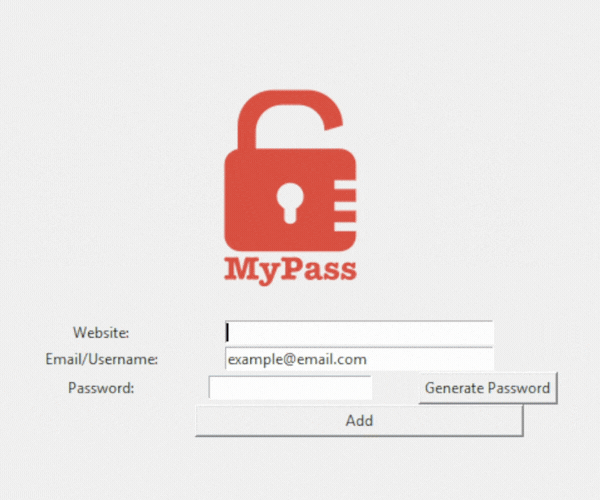

# Building a Password Manager GUI App with Tkinter
## Process
- Working with images and setting up the canvas.
- Use grid and columnspan to complete the user interface.
- Saving data to file.
- Dialog boxes and pop-ups in Tkinter.
- Generate a password and copy it to the clipboard.
## Password Manager

