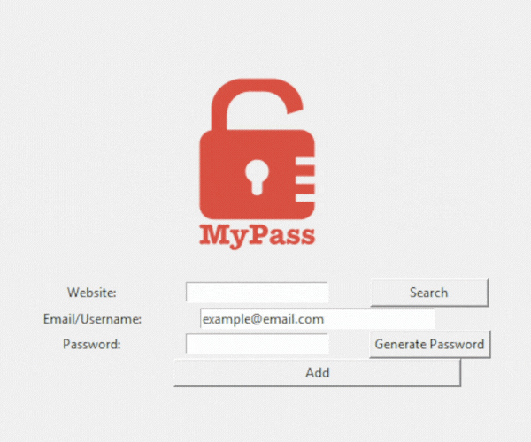

# Errors, Exceptions and JSON Data: Improving the Password Manager
## Concepts
- Catching exceptions: try, catch, except and finally pattern.
- Raising exceptions.
- IndexError Handling.
- KeyError Handling.
- Write, read and update JSON data.
## Password Manager v2

