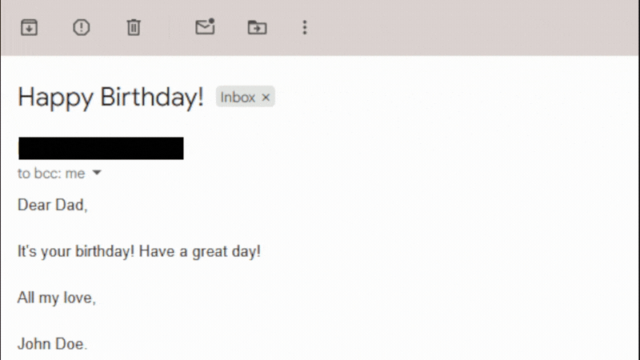
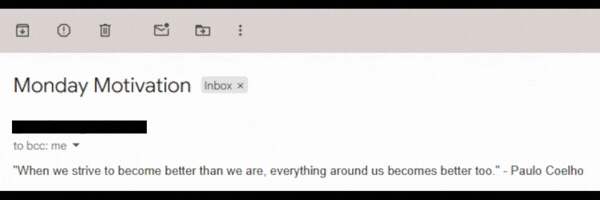

# Send Email (smtplib) & Manage Dates (datetime)
## Concepts
- How to send emails with Python using SMTP.
- Working with the datetime module.
## Automated Birthday Wisher Project

## Monday Motivation Project

